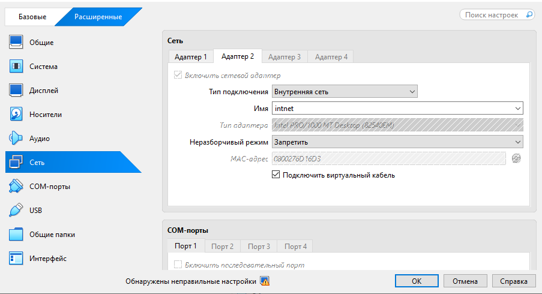
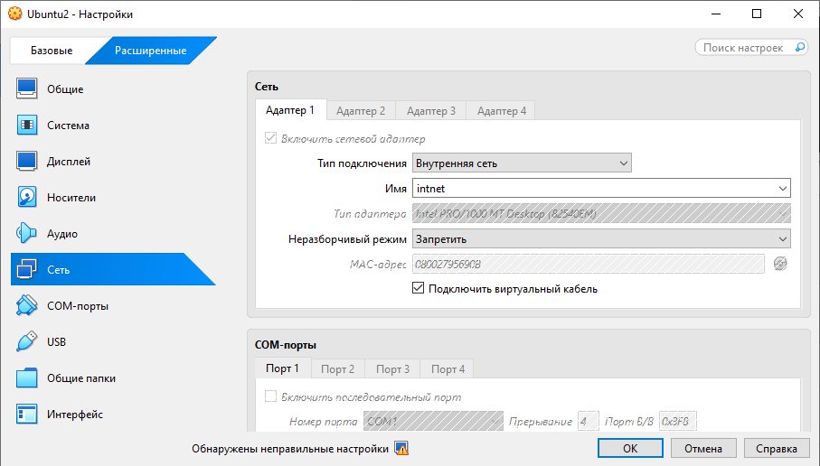
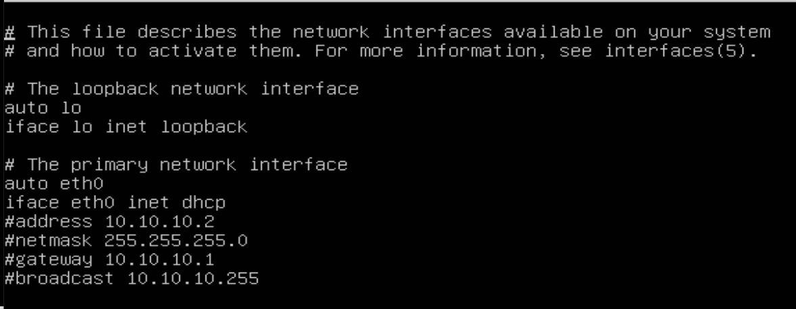
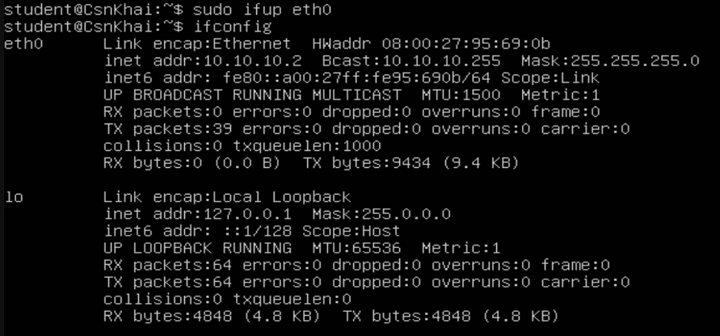
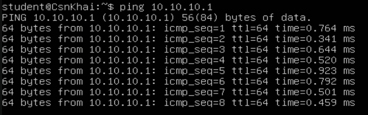
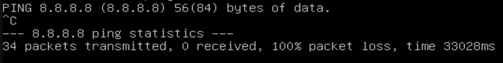
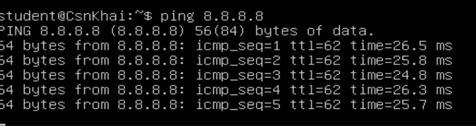
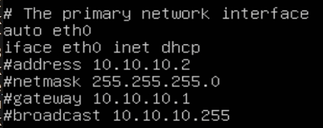
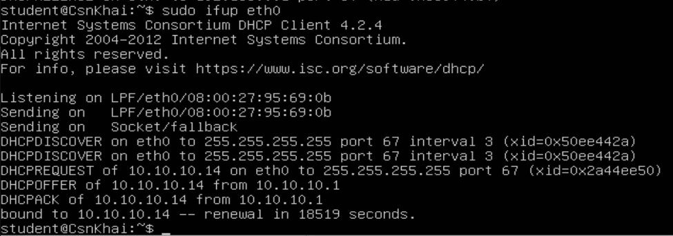
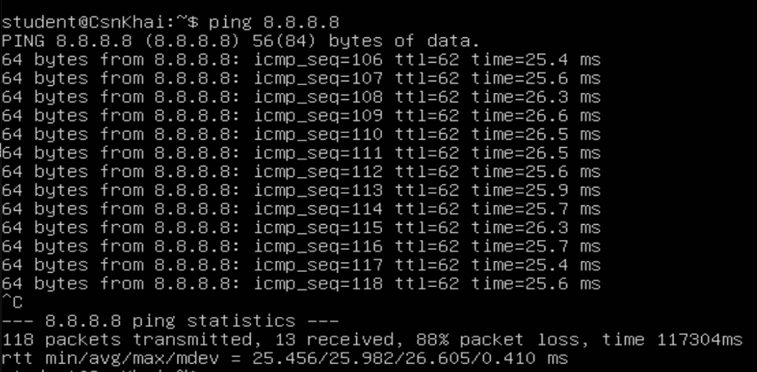

# Report on Lab_6

## Завдання на лабороторну 6

---
По перше для виконання роботи було вімкнено у основної убунту 2 адаптер для внутрішньої мережі та у клона було перший адаптер замінено також на внутрішню мережу:




Після цього було запищено основну систему та у файлі /etc/network/interfaces додано 2 мережу

```
# The loopback network interface
auto lo
iface lo inet loopback

# The primary network interface
auto eth0
iface eth0 inet dhcp

# The second network interface

auto eth1
iface eth1 inet static
address 10.10.10.1
netmask 255.255.255.0
broadcast 10.10.10.255
```

після було за допомогою sudo ifup eth1 було піднято нову внутрішню мережу:

```
student@CsnKhai:~$ ifconfig
eth0      Link encap:Ethernet  HWaddr 08:00:27:ed:14:1d
          inet addr:10.0.2.15  Bcast:10.0.2.255  Mask:255.255.255.0
          inet6 addr: fd17:625c:f037:2:6543:b998:6d:467f/64 Scope:Global
          inet6 addr: fe80::a00:27ff:feed:141d/64 Scope:Link
          inet6 addr: fd17:625c:f037:2:a00:27ff:feed:141d/64 Scope:Global
          UP BROADCAST RUNNING MULTICAST  MTU:1500  Metric:1
          RX packets:3208 errors:0 dropped:0 overruns:0 frame:0
          TX packets:2624 errors:0 dropped:0 overruns:0 carrier:0
          collisions:0 txqueuelen:1000
          RX bytes:259289 (259.2 KB)  TX bytes:1758482 (1.7 MB)

eth1      Link encap:Ethernet  HWaddr 08:00:27:6d:16:d3
          inet addr:10.10.10.1  Bcast:10.10.10.255  Mask:255.255.255.0
          inet6 addr: fe80::a00:27ff:fe6d:16d3/64 Scope:Link
          UP BROADCAST RUNNING MULTICAST  MTU:1500  Metric:1
          RX packets:0 errors:0 dropped:0 overruns:0 frame:0
          TX packets:7 errors:0 dropped:0 overruns:0 carrier:0
          collisions:0 txqueuelen:1000
          RX bytes:0 (0.0 B)  TX bytes:578 (578.0 B)

lo        Link encap:Local Loopback
          inet addr:127.0.0.1  Mask:255.0.0.0
          inet6 addr: ::1/128 Scope:Host
          UP LOOPBACK RUNNING  MTU:65536  Metric:1
          RX packets:16 errors:0 dropped:0 overruns:0 frame:0
          TX packets:16 errors:0 dropped:0 overruns:0 carrier:0
          collisions:0 txqueuelen:0
          RX bytes:1184 (1.1 KB)  TX bytes:1184 (1.1 KB)
```

Далі у другій системі у томуж файлі було налаштовано мережу:



Після чого знову було піднято мережу але у цей раз eth1




після було виконано пінг на внутрішню адресу першої машини 10.10.10.1 та 8.8.8.8 





у результаті пінгування внутрішньої адруси було виконано а зовнішньої ні

Для виправлення цього було виконано наступне:

спочатку у файлі /etc/sysctl.conf було розкоментовано рядок 

```
# Uncomment the next line to enable packet forwarding for IPv4
net.ipv4.ip_forward=1
```

після цього було перезапущено систему та написано команду sudo iptables -t nat -A POSTROUTING -o eth0 -j MASQUERADE

у результаті команда пінг 8.8.8.8 на 2 пристрої почала працювати коректно:



після цього юуло на основну систему встановлено dnsmasq

```
student@CsnKhai:~$ sudo apt install dnsmasq
Reading package lists... Done
Building dependency tree
Reading state information... Done
The following packages were automatically installed and are no longer required:
  libpvm3 libreadline-dev libreadline6-dev libtinfo-dev pvm
Use 'apt-get autoremove' to remove them.
The following extra packages will be installed:
  dnsmasq-base libmnl0 libnetfilter-conntrack3
The following NEW packages will be installed:
  dnsmasq dnsmasq-base libmnl0 libnetfilter-conntrack3
0 upgraded, 4 newly installed, 0 to remove and 196 not upgraded.
Need to get 325 kB of archives.
After this operation, 970 kB of additional disk space will be used.
Do you want to continue? [Y/n] y
WARNING: The following packages cannot be authenticated!
  dnsmasq-base dnsmasq
Install these packages without verification? [y/N] y
Get:1 http://us.archive.ubuntu.com/ubuntu/ trusty/main libmnl0 i386 1.0.3-3ubuntu1 [11.7 kB]
Get:2 http://us.archive.ubuntu.com/ubuntu/ trusty/main libnetfilter-conntrack3 i386 1.0.4-1 [46.9 kB]
Get:3 http://us.archive.ubuntu.com/ubuntu/ trusty-updates/main dnsmasq-base i386 2.68-1ubuntu0.2 [251 kB]
Get:4 http://us.archive.ubuntu.com/ubuntu/ trusty-updates/universe dnsmasq all 2.68-1ubuntu0.2 [14.9 kB]
Fetched 325 kB in 3min 10s (1,702 B/s)
Selecting previously unselected package libmnl0:i386.
(Reading database ... 54964 files and directories currently installed.)
Preparing to unpack .../libmnl0_1.0.3-3ubuntu1_i386.deb ...
Unpacking libmnl0:i386 (1.0.3-3ubuntu1) ...
Selecting previously unselected package libnetfilter-conntrack3:i386.
Preparing to unpack .../libnetfilter-conntrack3_1.0.4-1_i386.deb ...
Unpacking libnetfilter-conntrack3:i386 (1.0.4-1) ...
Selecting previously unselected package dnsmasq-base.
Preparing to unpack .../dnsmasq-base_2.68-1ubuntu0.2_i386.deb ...
Unpacking dnsmasq-base (2.68-1ubuntu0.2) ...
Selecting previously unselected package dnsmasq.
Preparing to unpack .../dnsmasq_2.68-1ubuntu0.2_all.deb ...
Unpacking dnsmasq (2.68-1ubuntu0.2) ...
Processing triggers for man-db (2.6.7.1-1ubuntu1) ...
Processing triggers for ureadahead (0.100.0-16) ...
ureadahead will be reprofiled on next reboot
Setting up libmnl0:i386 (1.0.3-3ubuntu1) ...
Setting up libnetfilter-conntrack3:i386 (1.0.4-1) ...
Setting up dnsmasq-base (2.68-1ubuntu0.2) ...
Setting up dnsmasq (2.68-1ubuntu0.2) ...
 * Starting DNS forwarder and DHCP server dnsmasq                                                                                                           [ OK ]
Processing triggers for libc-bin (2.19-0ubuntu6.6) ...
Processing triggers for ureadahead (0.100.0-16) ...
```

після було перевірено стан dnsmasq

а після у файлі /etc/dnsmasq.conf було зроблено наступні налаштування:

```
# If you want dnsmasq to listen for DHCP and DNS requests only on
# specified interfaces (and the loopback) give the name of the
# interface (eg eth0) here.
# Repeat the line for more than one interface.
interface=eth1

# Uncomment this to enable the integrated DHCP server, you need
# to supply the range of addresses available for lease and optionally
# a lease time. If you have more than one network, you will need to
# repeat this for each network on which you want to supply DHCP
# service.
dhcp-range=10.10.10.10,10.10.10.20,12h
```

У 2 сисстемі зенову змінюємо файл і переводимо адаптер на dhcp



після цього перезапускаємо першу систему

Після перезупуску перезапускаємо на 2 машині мережу eth0



і знову робимо пінг 8.8.8.8 



Дані налаштуємо dns

перевіряємо файл /etc/resolv.conf

```

# Dynamic resolv.conf(5) file for glibc resolver(3) generated by resolvconf(8)
#     DO NOT EDIT THIS FILE BY HAND -- YOUR CHANGES WILL BE OVERWRITTEN
nameserver 127.0.0.1

```

після цього розкоментовуємо рядок prepend domain-name-servers 127.0.0.1; у файлі /etc/dhcp/dhclient.conf

```
#send host-name "andare.fugue.com";
send host-name = gethostname();
#send dhcp-client-identifier 1:0:a0:24:ab:fb:9c;
#send dhcp-lease-time 3600;
#supersede domain-name "fugue.com home.vix.com";
prepend domain-name-servers 127.0.0.1;
request subnet-mask, broadcast-address, time-offset, routers,
        domain-name, domain-name-servers, domain-search, host-name,
        dhcp6.name-servers, dhcp6.domain-search,
        netbios-name-servers, netbios-scope, interface-mtu,
        rfc3442-classless-static-routes, ntp-servers,
        dhcp6.fqdn, dhcp6.sntp-servers;
```

для перевірки виконаємо команду dig google.com:

```
student@CsnKhai:~$ dig google.com

; <<>> DiG 9.9.5-3ubuntu0.5-Ubuntu <<>> google.com
;; global options: +cmd
;; Got answer:
;; ->>HEADER<<- opcode: QUERY, status: NOERROR, id: 41560
;; flags: qr rd ra; QUERY: 1, ANSWER: 6, AUTHORITY: 0, ADDITIONAL: 1

;; OPT PSEUDOSECTION:
; EDNS: version: 0, flags:; udp: 4096
;; QUESTION SECTION:
;google.com.                    IN      A

;; ANSWER SECTION:
google.com.             248     IN      A       142.250.109.102
google.com.             248     IN      A       142.250.109.139
google.com.             248     IN      A       142.250.109.113
google.com.             248     IN      A       142.250.109.138
google.com.             248     IN      A       142.250.109.100
google.com.             248     IN      A       142.250.109.101

;; Query time: 15 msec
;; SERVER: 127.0.0.1#53(127.0.0.1)
;; WHEN: Thu Nov 19 18:20:24 UTC 2026
;; MSG SIZE  rcvd: 135

```

у результаті видно що у полі SERVER видно нашу адрусу яку ми розкоментували

### Висновки

Під час виконання лабораторної роботи було організовано віртуальну локальну мережу між двома віртуальними машинами Ubuntu та налаштовано основну систему як шлюз і сервер мережевих служб. У результаті увімкнення маршрутизації пакетів (ip_forward) і налаштування NAT (iptables MASQUERADE) було забезпечено доступ клієнтської машини до зовнішньої мережі Інтернет через основний хост. Крім того, розгортання та конфігурування служби dnsmasq дозволило автоматизувати видачу IP-адрес у внутрішній підмережі по протоколу DHCP та організувати локальне кешування DNS-запитів, працездатність чого успішно підтверджено за допомогою утиліт ping та dig.